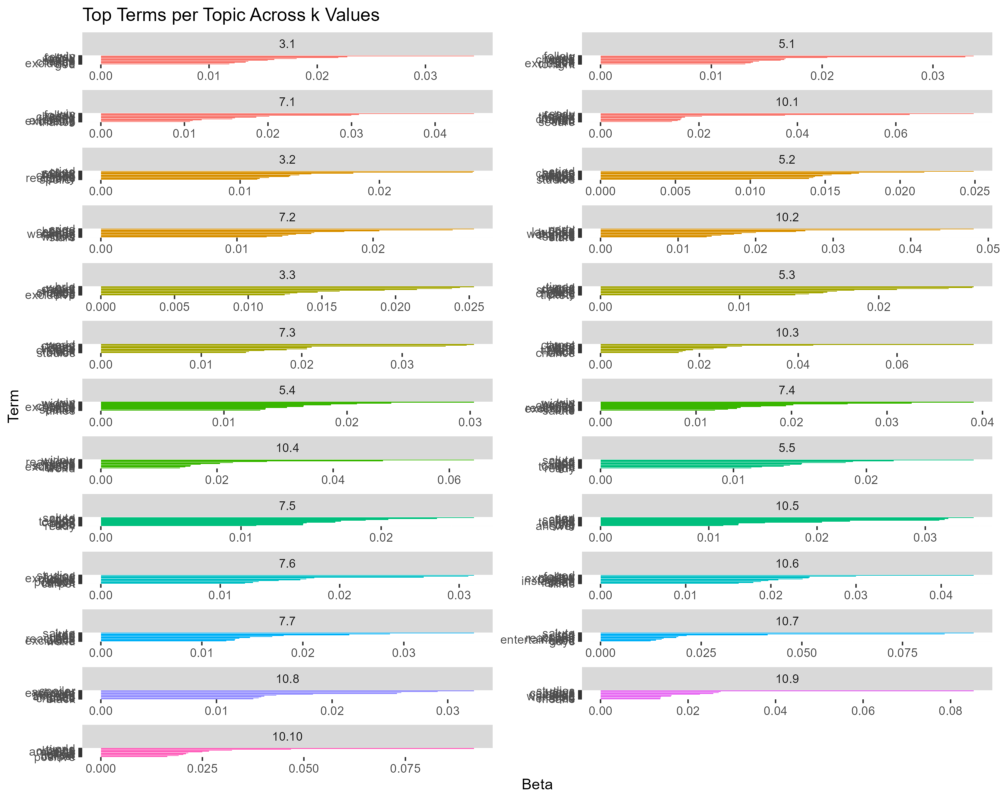
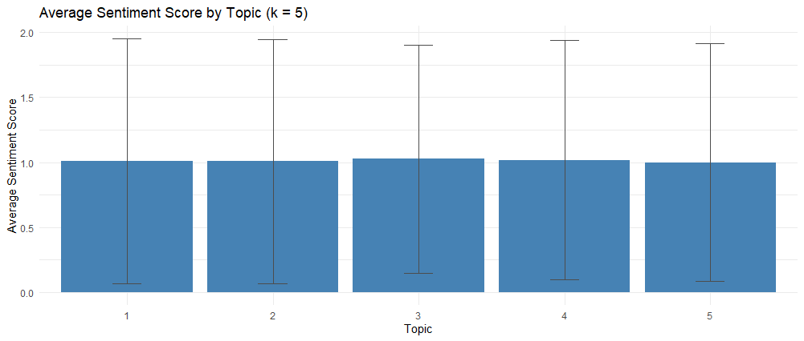

# Avengers: Endgame Tweet Topic Modelling and Sentiment Analysis

Analyses 15,000 tweets containing #AvengersEndGame to find what audiences were talking about and how they felt, using LDA topic modelling and lexicon-based sentiment analysis in R. The project follows the CRISP-DM framework.

Module: ANL312 Text Mining and Applied Project Formulation, Singapore University of Social Sciences (2025)

> **Disclaimer:** This is an academic project completed for coursework. It is not affiliated with, endorsed by or commissioned by Marvel Studios or The Walt Disney Company. The analysis uses a publicly available dataset of tweets, and the findings do not represent Marvel's own data or views.

## Approach

1. **Clean the tweets:** remove URLs, mentions, hashtags, emojis and non-letter characters, split CamelCase words, then lowercase.
2. **Build a custom stopword list:** combine the `tidytext` stopwords with actor names, advertisers and platform terms, while keeping superhero names for analysis.
3. **Tokenise and filter:** drop very short tokens and tokens with digits or no vowels.
4. **Topic modelling:** train LDA models with k = 3, 5, 7 and 10 and compare them using top terms, topic distribution, term overlap and coherence scores.
5. **Sentiment analysis:** score each tweet with the Bing lexicon (positive words minus negative words) and summarise it by topic.

## Model selection

| k | Coherence score |
|---|---|
| 3 | 0.41 |
| **5** | **0.52** |
| 7 | 0.47 |
| 10 | 0.43 |

k = 5 gave the most coherent and clearly separated topics. k = 3 was too broad, and k = 10 split themes into overlapping fragments.



## Final topics and sentiment

| Topic | Label | Avg. sentiment | Tweets |
|---|---|---|---|
| 1 | Fan Anticipation & Emotional Reactions | 1.01 | 1,533 |
| 2 | Premiere Events & Cast Tributes | 1.01 | 1,696 |
| 3 | Ticketing, Cast Mentions & Red Carpet | 1.03 | 1,632 |
| 4 | Spoilers & Character Moments | 1.02 | 1,258 |
| 5 | Red Carpet & Fan Celebrations | 1.00 | 1,666 |



**Key findings**

- Sentiment was positive across every topic, with very little backlash.
- Ticketing and cast mentions scored highest, showing strong excitement around premieres and the cast.
- For future campaigns, the results suggest focusing on cast visibility, premiere events and fan engagement.

## Repository structure

```
avengers_topic_modelling.R   Full pipeline: cleaning, LDA, evaluation, sentiment
outputs/                     Charts and summary tables produced by the script
```

## How to run

1. Download the #AvengersEndGame tweets dataset from Kaggle and save it as `data/AvengersEndGame_tweets.csv`.
2. Install the packages:

```r
install.packages(c("tidytext", "dplyr", "tidyr", "stringr", "readr", "tm", "topicmodels", "ggplot2", "scales"))
```

3. Run `avengers_topic_modelling.R` in RStudio.

## Skills demonstrated

- Text cleaning and tokenisation with `tidytext` and `stringr`
- LDA topic modelling with `topicmodels`, including choosing the number of topics
- Lexicon-based sentiment analysis
- Data visualisation with `ggplot2`

## Author

Jawenn Lim
